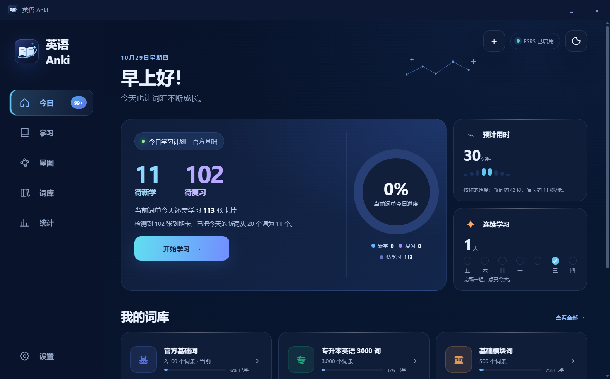
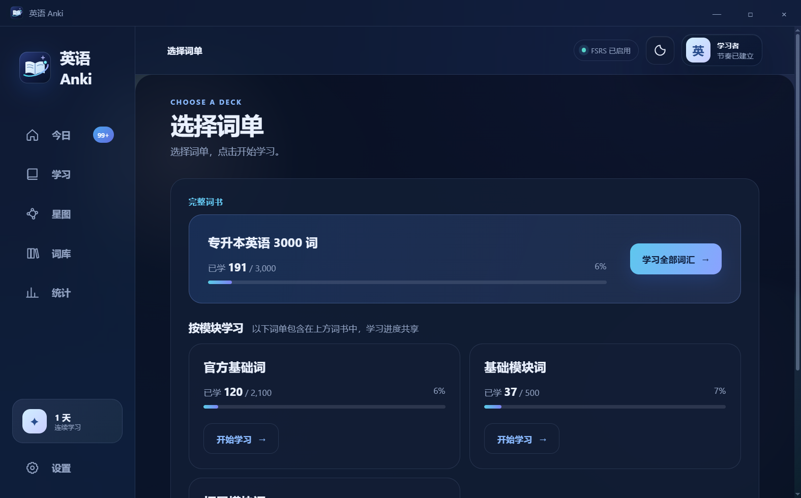
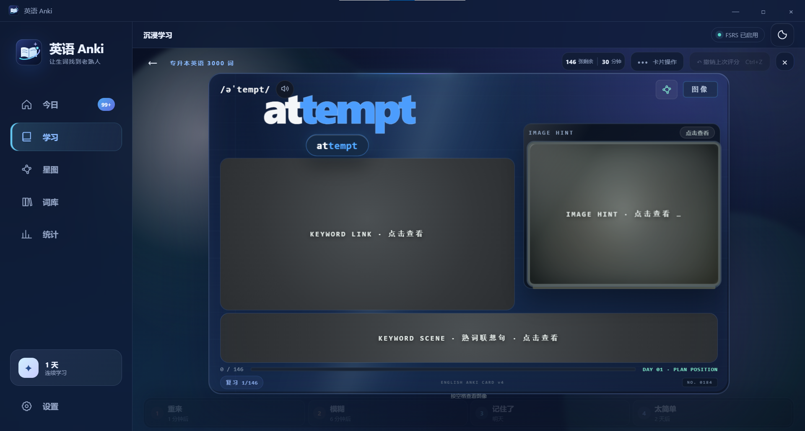
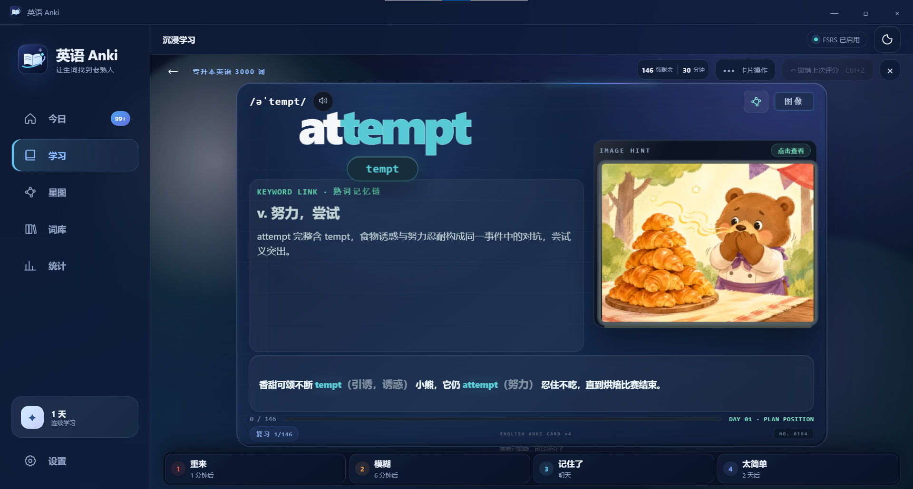
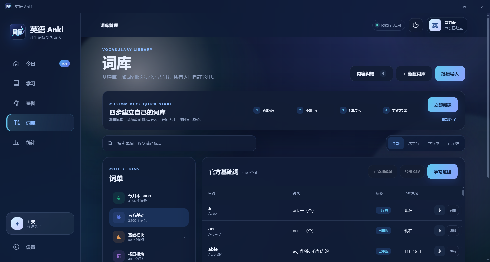
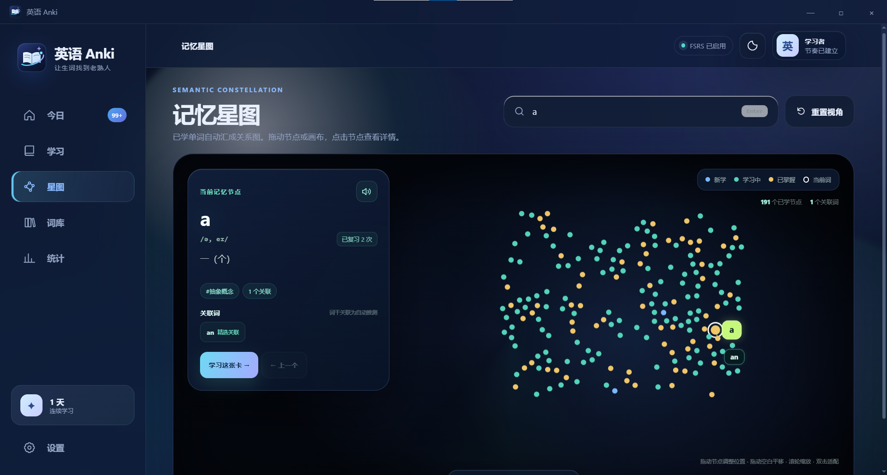
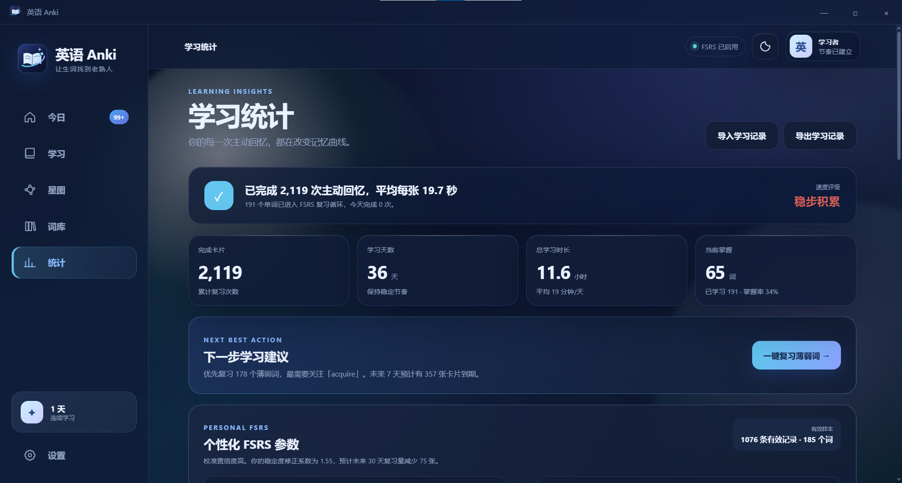
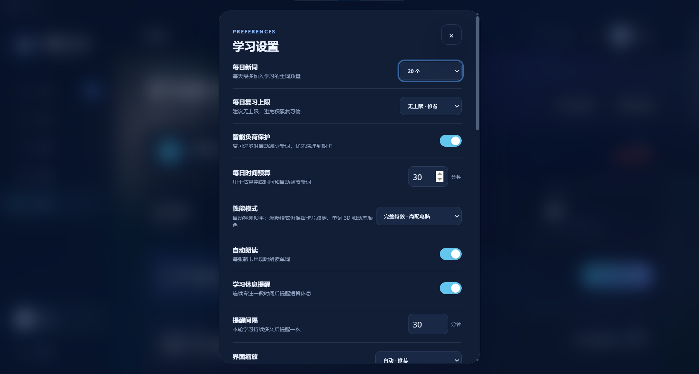

# 英语 Anki

熟词锚点记忆、场景插画与 FSRS 间隔复习一体化的英语学习桌面应用。每个词条由「熟词锚点 → 场景插画 → 具体事件联想句」构成，复习节奏由 FSRS 按你的实际表现安排。

> 当前版本 **4.2.0** · 源码公开、非商业免费 · Windows 10/11 x64 · 本地优先、无账号、无云端依赖

**下载最新安装包：** [GitHub Releases](https://github.com/SeanStellar/english-anki/releases/latest)

## 界面预览

以下截图来自实际运行的应用。

### 今日计划



首页按当天到期卡片和可用时间生成学习计划：待新学、待复习、预计用时、连续学习天数和各词库进度都集中在一屏。新词数量会根据每日预算和智能负荷保护自动调整。

### 选择词单



开始学习前先选择词单。上方是完整词书，下方按模块拆分；模块词单包含在完整词书中，学习进度共享。

### 沉浸学习





先尝试回忆，再揭晓熟词锚点、场景插画和联想句。卡片底部按「重来 / 模糊 / 记住了 / 太简单」评分，FSRS 会根据评分安排下一次复习。

### 词库



支持搜索单词、释义和音标，按未学习/学习中/已掌握筛选，查看每个词的状态和下次复习时间；也可以添加单词、批量导入、导出 CSV 或导出 Anki `.apkg` 词库包。

### 记忆星图



已学单词会自动汇成关系图：颜色区分新学、学习中、已掌握和当前词；支持拖动画布、滚轮缩放、搜索定位和点击节点进入复习。

### 学习统计



统计页汇总主动回忆次数、学习天数、总学习时长和当前掌握词数，并给出下一步学习建议、薄弱词复习入口和个性化 FSRS 参数。

### 学习设置



可调整每日新词、每日复习上限、智能负荷保护、每日时间预算、性能模式、自动朗读、学习休息提醒和界面缩放。

## 功能

- 专升本英语 3000 词通用词库（高职英语课程标准附录），3000 张场景插画
- 多词书清单：内置词书由 `renderer/data/decks.json` 管理，可继续扩展四级、六级、雅思、考研等词书
- 熟词锚点联想、图像提示与逐步揭晓
- FSRS 间隔复习、每日新词/复习上限、负荷保护
- 自定义词库：CSV/TSV/TXT 导入、CSV 导出、编辑与内容纠错
- Anki 词库包（.apkg）导出：任意词库可导出，内置词库附带场景插画
- 学习统计、记忆星图、薄弱词复习、个性化 FSRS 校准
- SHA-256 备份、gzip 备份、旧备份兼容、跨设备文件夹同步
- 本地优先；无账号、无云端依赖

## 下载与安装

- 安装包：[English-Anki-4.2.0-Setup.exe](https://github.com/SeanStellar/english-anki/releases/download/v4.2.0/English-Anki-4.2.0-Setup.exe)
- 系统：Windows 10/11 x64
- 授权：个人、学习、研究等非商业使用免费；商业使用需单独授权，见 [COMMERCIAL-LICENSE.md](COMMERCIAL-LICENSE.md)
- 安装包暂未代码签名，Windows SmartScreen 提示时选择「更多信息 → 仍要运行」
- 覆盖安装会沿用本机学习记录；升级前建议在应用内先备份

## 参与测试

v4.2.0 已发布，欢迎安装试用。测试清单、重点流程和已知限制见 [TESTING.md](TESTING.md)；发现问题可以直接用 [测试反馈模板](https://github.com/SeanStellar/english-anki/issues/new?template=test_report.yml) 提交，也可以直接在 [公开测试 Issue #1](https://github.com/SeanStellar/english-anki/issues/1) 留言。

反馈时请附上：应用版本、Windows 版本、安装方式、复现步骤和截图。请不要上传自己的学习记录或备份文件。

## 社区交流

- QQ 群：**1056570825**（开源英语 Anki 交流群）

## 多词书

新增四级、六级、雅思、考研等词书不需要改代码：

1. 在 `renderer/data/` 放入词条数组 JSON，每条至少包含 `id`、`word`、`phonetic`、`pos`、`meaning`、`tier`、`tierName`、`deckId`；`id` 全局唯一。
2. 在 `decks.json` 的 `decks` 数组追加一项：`id`、`name`、`short`、`desc`、`color`、`icon`、`file`；需要分层时再加 `tiers` 数组（每层带 `id`、`name`、`tier`）。
3. 重启应用，首页和词库页会自动出现新词书；`defaultDeck` 决定默认进入哪一本。

## 开发

要求 Node.js 22+。

```bash
npm install
npm start                  # 启动应用
npm test                   # 单元测试
npm run test:integration   # Electron 备份恢复集成测试
npm run dist               # 构建 NSIS 安装程序与便携版
```

`npm run dist` 输出 `dist/English-Anki-4.2.0-Setup.exe` 和 `dist/English-Anki-4.2.0-Portable.exe`。

## 数据位置

- 安装版：`%APPDATA%\english-anki`
- 便携版：exe 同目录的 `EnglishAnkiData`
- 备份：默认在用户数据目录的 `backups`，自动保留最近 20 份
- 同步：选择 OneDrive/坚果云等目录后生成 `english-anki-sync.json`

## 目录

```text
main.js                  Electron 主进程、数据/备份/同步/窗口
apkg-export.js           Anki .apkg 词库包生成
preload.bundle.js        sandbox preload
renderer/                前端页面、样式、词库和故事数据
  assets/memory-scenes/  3000 张 800x600 WebP 插画
  data/decks.json        内置词书清单
  data/zhuanshengben-3000.json  通用专升本 3000 词
docs/screenshots/        应用界面截图
tests/                   单元测试与 Electron 集成测试
tools/                   词库审核工具
audit/                   词库审核报告
```

## 说明

- 插画为 800×600 WebP；原始 960×720 版本另行备份，不在仓库中。
- 故事句经过批量重写与自动审计，仍建议对内容做人工抽查。
- `.apkg` 导出使用 Anki 兼容的 `anki-apkg-export` 生成；导入后的卡片是全新卡片，不继承应用内 FSRS 进度。

## 授权与商业使用

本项目从 **v4.2.0** 起采用双授权：

- **代码**：PolyForm Noncommercial License 1.0.0。个人、学习、研究等非商业用途免费；商业使用需单独授权，完整条款见 [LICENSE](LICENSE)。
- **素材**：内置截图、场景插画、故事句、释义编排等采用 CC BY-NC 4.0，署名 SeanStellar / 英语 Anki，详见 [LICENSE-ASSETS.md](LICENSE-ASSETS.md)。
- **商业授权**：邮箱 s3156708512@163.com，QQ 3156708512；适用场景和说明见 [COMMERCIAL-LICENSE.md](COMMERCIAL-LICENSE.md)。
- **历史版本**：v4.1.0 及更早按 MIT 发布。MIT 已授予的权利不可撤回，继续适用于那些版本；v4.2.0 起适用上述非商业授权。
- **品牌**：代码和素材许可不包含商标许可；“英语 Anki”名称、图标和品牌标识未经许可不得用于商业招生、卖课或暗示官方背书。
- **说明**：本项目是“源码公开、非商业免费”，不是 OSI 定义下的开源许可证。商业合作建议由双方律师审阅合同。
